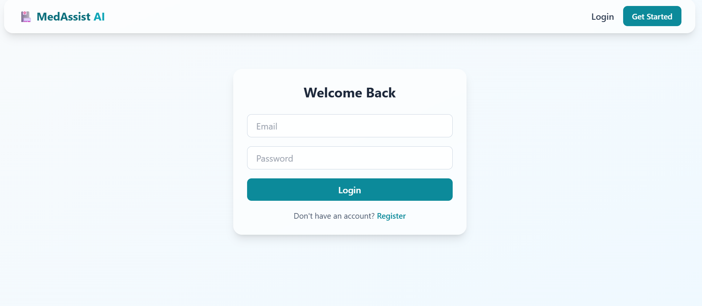
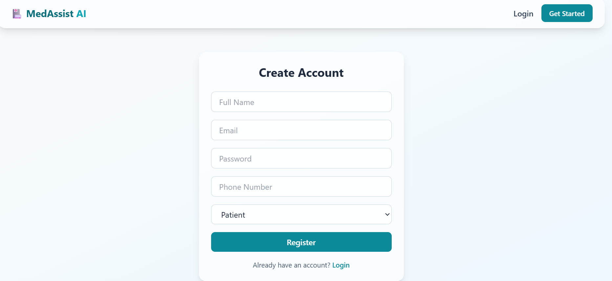
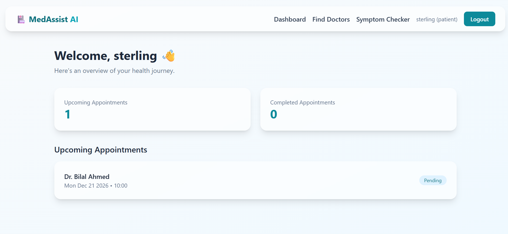
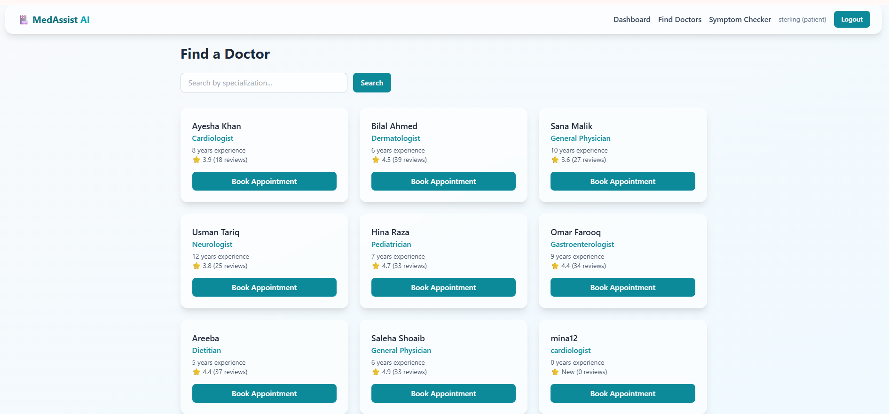
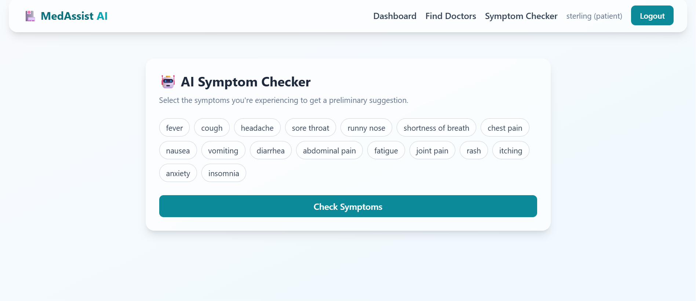
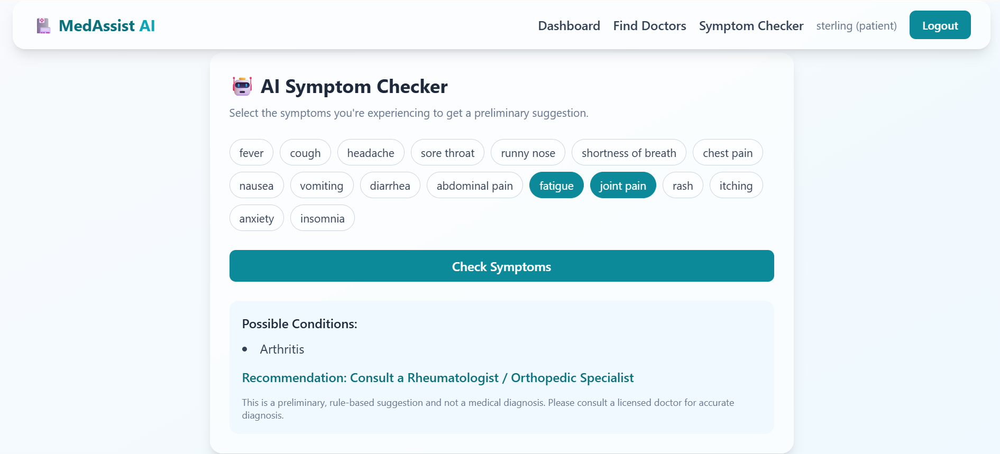

# MedAssist AI: Health Appointment & Symptom Management System

A full-stack MERN web application that helps patients book appointments with doctors, manage their medical history, and get preliminary health suggestions based on symptoms. Includes secure role-based dashboards for **Patients**, **Doctors**, and **Admins**.

**Live demo:** https://medassist-ai-eta.vercel.app
(The backend runs on Render's free tier, so the first request may take 30-60 seconds to wake up.)


## Features

- **Authentication**: Register/Login, JWT auth, bcrypt password hashing, forgot/reset password
- **Doctor Management**: profiles, specializations, experience, ratings, availability
- **Appointment Booking**: book, cancel, reschedule, view history
- **Symptom Checker (rule-based)**: suggests possible conditions and a specialist recommendation; can be upgraded to an OpenAI/ML model later
- **Role-based Dashboards**: separate views for Patient, Doctor, and Admin
- **Analytics**: daily appointments, monthly patient growth, popular doctors (Recharts)
- **Email Notifications**: appointment confirmations via Nodemailer
- **Responsive UI**: Tailwind CSS + Framer Motion with a glassmorphism design

## Screenshots









## Tech Stack

- **Frontend:** React, Vite, Tailwind CSS, Axios, React Router, Recharts, Framer Motion
- **Backend:** Node.js, Express.js, JWT, bcryptjs, Nodemailer
- **Database:** MongoDB Atlas (Mongoose)
- **Deployment:** Vercel (frontend), Render (backend)

## Project Structure

```
medassist-ai/
├── backend/
│   ├── config/         # DB connection
│   ├── models/         # User, Doctor, Appointment schemas
│   ├── middleware/     # auth (JWT) & role-based access
│   ├── controllers/    # business logic
│   ├── routes/         # API endpoints
│   ├── utils/          # email sender, rule-based symptom engine
│   └── server.js
└── frontend/
    └── src/
        ├── api/         # axios instance with JWT interceptor
        ├── context/     # AuthContext (global auth state)
        ├── components/  # Navbar, ProtectedRoute
        └── pages/       # Home, Login, Register, Dashboards, etc.
```

## Getting Started

### 1. Backend Setup

```
cd backend
npm install
cp .env.example .env   # then fill in your Mongo URI, JWT secret, email creds
npm run dev
```

Backend runs at `http://localhost:5000`

### 2. Frontend Setup

```
cd frontend
npm install
npm run dev
```

Frontend runs at `http://localhost:5173` (Vite dev server proxies `/api` to the backend)

### 3. Environment Variables (`backend/.env`)

```
PORT=5000
MONGO_URI=your_mongodb_atlas_connection_string
JWT_SECRET=your_jwt_secret
JWT_EXPIRE=7d
EMAIL_HOST=smtp.gmail.com
EMAIL_PORT=587
EMAIL_USER=your_email@gmail.com
EMAIL_PASS=your_app_password
CLIENT_URL=http://localhost:5173
```

> MongoDB Atlas and Nodemailer credentials are required for the app to fully work (authentication, password reset emails, appointment confirmations). Data persistence needs a live database connection.

## Creating Accounts

Register with role `patient` or `doctor` from the Register page. To create an `admin` account, register a normal user and then manually change their `role` field to `"admin"` in MongoDB Atlas. There is no public admin signup, by design.

## About the Symptom Checker

The symptom checker uses a **transparent, rule-based matching engine** (`backend/utils/symptomEngine.js`) that maps common symptom combinations to possible conditions and a recommended specialist. It does not use machine learning. This keeps the MVP fast, dependency-free, and fully explainable.

It is designed as a drop-in replacement point: the internals of `analyzeSymptoms()` can be swapped for a call to the OpenAI API or a trained ML model without changing the controller or the frontend.

## Limitations

- The symptom checker is rule-based, covers only common symptom combinations, and gives preliminary, non-diagnostic suggestions only.
- Appointment emails and password reset require SMTP credentials to be configured.
- Admin accounts must be created manually in the database.

## Disclaimer

This project is for educational and portfolio purposes. The symptom checker does **not** provide medical diagnoses. It only offers preliminary, non-binding suggestions. Always consult a licensed medical professional.

## Author

Amna Shoaib, BS Information Technology, MNS University of Agriculture, Multan, Pakistan  
GitHub: [@amnashoaib2510-cloud](https://github.com/amnashoaib2510-cloud)

## License

MIT, free to use for learning and portfolio purposes.
